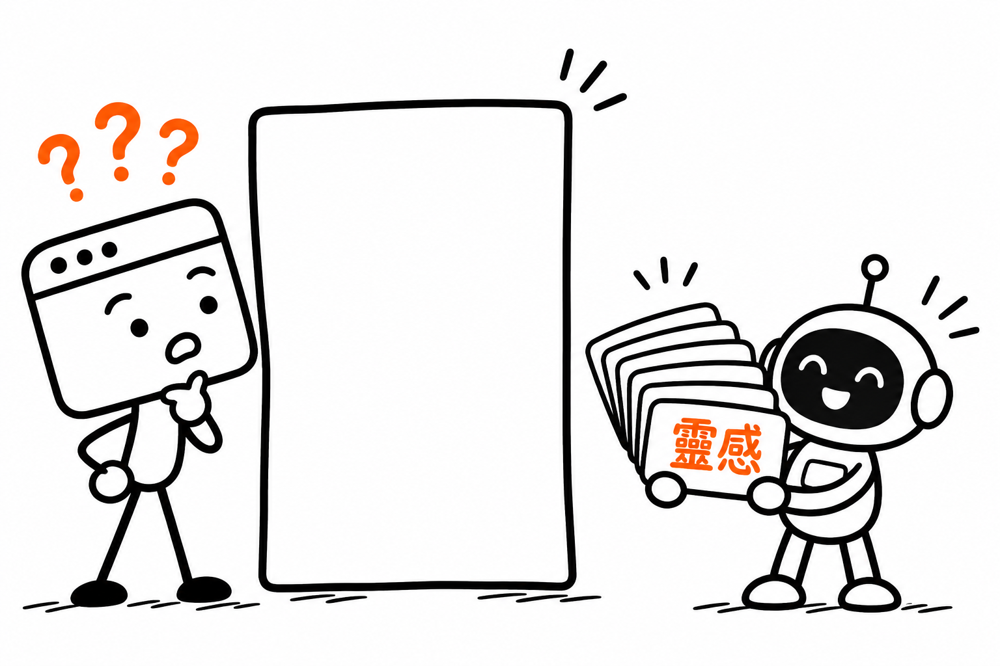
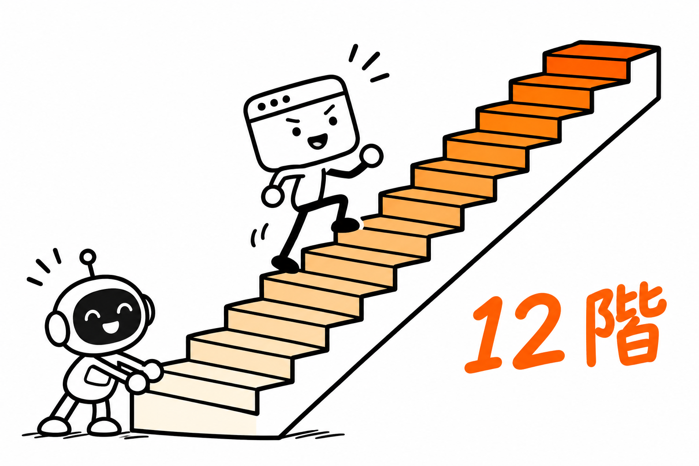
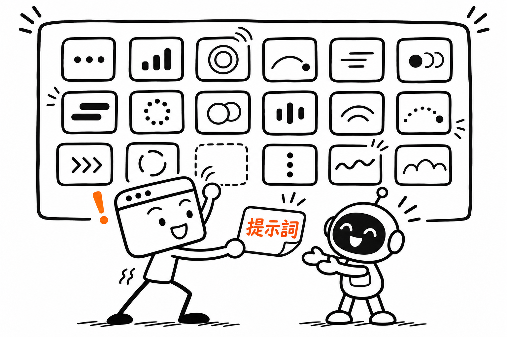

> 這篇的網站清單來自 IG 上 [@carllee2077](https://www.instagram.com/carllee2077/) 的短影片，費用與功能是我 11/20 查官網和評測文章整理的，之後可能會變。

先講結論：6 個裡面，我只會天天開兩個——**kittenjam Motion Library** 跟 **Radix Colors**。

兩個都免費，也剛好對得上我平常的技術棧：動效用 GSAP、配色接 Tailwind。另外四個不是不好，而是比較適合「提案前找方向」，不是每天寫 code 會用到的。

前端工程師接案最常卡的三個地方，大概就是：沒靈感、不會配色、看到很酷的動效卻叫不出名字，所以沒辦法跟 AI 講清楚要做什麼。這 6 個網站剛好各補一塊。

<figure>
  
  <figcaption>空白畫布最可怕，先找參考再動手。</figcaption>
</figure>

---

## 一張表看完

| # | 網站 | 解決什麼 | 費用 | 適合時機 |
| --- | --- | --- | --- | --- |
| 1 | <a href="https://www.awwwards.com/" target="_blank" rel="noopener noreferrer">Awwwards</a> | 看得獎網站長怎樣、用了什麼技術 | 瀏覽免費 | 提案找參考 |
| 2 | <a href="https://variant.com/" target="_blank" rel="noopener noreferrer">Variant</a> | AI 一次生好幾種版面和配色 | 免費版每月 300 次；Pro 每月 20 美元 | 早期發想 |
| 3 | <a href="https://minimal.gallery/" target="_blank" rel="noopener noreferrer">minimal.gallery</a> | 極簡風網站收藏 | 免費 | 畫面太花、想做減法 |
| 4 | <a href="https://motionsites.ai/" target="_blank" rel="noopener noreferrer">MotionSites</a> | 電影感首屏的 AI 提示詞 | 範例免費看；完整提示詞一次買斷 29 美元（創始價） | 想做有記憶點的首屏 |
| 5 | <a href="https://www.radix-ui.com/colors" target="_blank" rel="noopener noreferrer">Radix Colors</a> | 12 階配色系統 | 免費、開源 | 每天寫 UI |
| 6 | <a href="https://kittenjam-motion-library.vercel.app/" target="_blank" rel="noopener noreferrer">kittenjam Motion Library</a> | 327 種網頁動效＋複製 AI 提示詞 | 免費、不用註冊 | 每天寫 UI |

---

## 1. Awwwards：看別人得獎的作品

<a href="https://www.awwwards.com/" target="_blank" rel="noopener noreferrer">Awwwards</a> 是國際網頁設計獎，每天選一個 Site of the Day。

對前端來說，它最有用的地方不是「好看」，而是可以看到那些網站用了什麼技術。Three.js、GSAP、WebGL 這類作品很多，拿來跟客戶溝通「我們想做到這種感覺」很直接。

缺點是得獎作品通常是品牌形象站，預算跟時程都很寬。接案時要提醒自己：參考的是方向，不是照抄規格。

## 2. Variant：讓 AI 先幫你畫幾個方向

<a href="https://variant.com/" target="_blank" rel="noopener noreferrer">Variant</a> 是 AI 設計工具，輸入需求後一次產出好幾種版面，往下捲就一直生新的。可以打亂版面、重混配色，也可以從一個設計延伸出三種方向。

免費版每月 300 次快速設計，Pro 每月 20 美元。

我會把它當成「提案前的草稿機」。評測提到它不能對話式局部修改，有小錯只能整個重生；我查到的資料也都沒提到能匯出程式碼。所以它適合找方向，不適合直接拿來當交付物。

## 3. minimal.gallery：想做減法時看這裡

<a href="https://minimal.gallery/" target="_blank" rel="noopener noreferrer">minimal.gallery</a> 專門收極簡風的網站。

做後台、做 B2B 產品頁的時候，最常犯的錯就是什麼都想放。卡住的時候來這裡逛一圈，通常就知道哪些東西可以拿掉。

## 4. MotionSites：電影感首屏的提示詞庫

<a href="https://motionsites.ai/" target="_blank" rel="noopener noreferrer">MotionSites</a> 收的是 Hero Section（首屏）的動態範例，每個範例都有對應的結構化提示詞，貼到 Claude Code、Cursor 這類工具就能生出類似的首屏。

範例可以免費看，完整提示詞要一次買斷，創始價 29 美元（原價 199 美元）。

兩個要注意的地方：

- 它只做首屏，不是整站模板。
- 提示詞是照 React + Tailwind v4 + Framer Motion 寫的。如果你跟我一樣寫 Vue，要請 AI 幫你改寫成 Vue 跟 GSAP 的版本。

## 5. Radix Colors：不會配色就照 12 階走

<a href="https://www.radix-ui.com/colors" target="_blank" rel="noopener noreferrer">Radix Colors</a> 是我最推薦的一個。

它把每個顏色切成 12 階，而且**每一階都有固定用途**：前兩階是背景、中間幾階是元件和邊框、後面是實心色和文字。淺色、深色模式都有對應版本。

這對工程師很友善。你不用懂色彩學，只要記住「這一階是拿來當 hover 背景的」，畫面就不太會亂。它也有 CSS 變數檔，接到 Tailwind 或自己的設計 token 都很快。

<figure>
  
  <figcaption>12 階各有用途，照著用就不容易配錯。</figcaption>
</figure>

## 6. kittenjam Motion Library：叫不出名字的動效，在這裡都有

<a href="https://kittenjam-motion-library.vercel.app/" target="_blank" rel="noopener noreferrer">Motion Library</a> 是 UI/UX 設計師 Hannah 整理的動效庫，目前收了 327 種：CSS 194 種、GSAP 119 種、Canvas 14 種。介面是繁體中文。

每個效果都能直接在網頁上試玩，還有一個「複製 AI 提示詞」按鈕。提示詞描述的是動作、節奏和時間長度，不含顏色，所以很容易套進自己的網站風格。

我覺得它最大的價值是**幫你把動效講清楚**。以前看到一個很順的卡片翻牌效果，只能跟 AI 說「做一個很順的翻牌」，現在直接複製它的描述貼過去，生出來的東西準很多。

使用前要注意一點：站方說明效果名稱與描述屬原作者整理，預覽是示意重製，僅供個人參考學習。商業專案要用之前，記得先確認原作者的授權。

<figure>
  
  <figcaption>看到喜歡的動效，複製提示詞交給 AI。</figcaption>
</figure>

---

## 我會怎麼搭配

- **提案前**：Awwwards 找方向、minimal.gallery 確認不要過頭，需要的話用 Variant 快速畫幾版給客戶挑。
- **開始寫 code**：Radix Colors 定好色票，動效從 Motion Library 複製提示詞給 Claude Code，請它用 GSAP 寫成 Vue 元件。
- **首屏想要記憶點**：參考 MotionSites 的範例，但提示詞要先改成自己的技術棧。

工具會一直換，但流程大概就是這樣：**先找參考、再定規則、最後把需求講清楚交給 AI**。

你平常找 UI 靈感都去哪裡？歡迎留言跟我分享。
